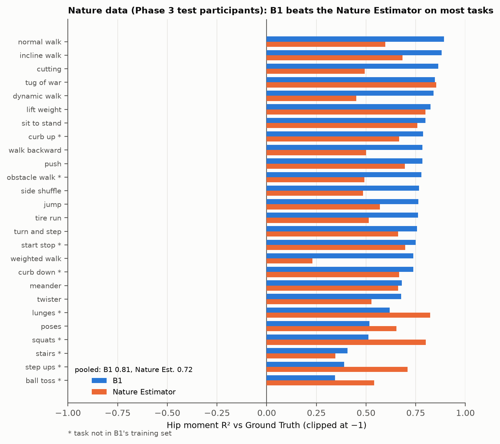
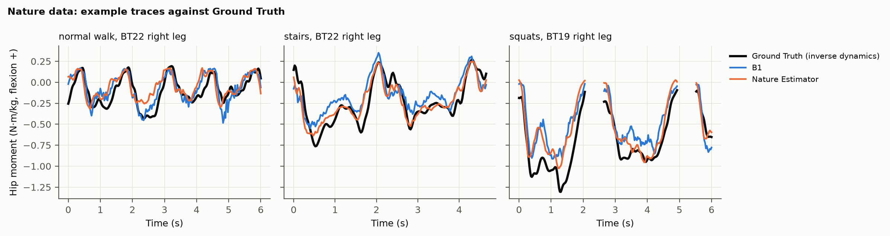

# D02: B1 as a TensorRT engine on the Jetson: conversion, latency, and a real-data check

| Field | Value |
|---|---|
| ID | D02 |
| Date | 2026-10-27 |
| Dataset | Nature 2024 validation participants (2048 windows, all 26 tasks) |
| Status | Complete |
| Sources | E41 (B1, `hip_thigh_aug_s2`: best seed on validation, hip R² 0.807 on the paper tasks) |
| Code / notebooks | `deployment/moment_model.py`, `moment_engine.py`, `send_moment.sh`, `export_check_windows.py`, `check_moment_real.py`; on the Jetson `~/hip-exo/ml/nature/estimator/runs/hip_thigh_aug_s2/{moment.engine, moment.json, check_real.json}` |

## Hypothesis

- **(a)** B1 converts to a TensorRT engine on the Jetson Orin Nano (TensorRT 10.3) without changing its outputs: the
  engine matches PyTorch on the same GPU to well under the model's error (validation RMSE about 0.19 N·m/kg).
- **(b)** It runs well inside the deployed loop's 10 ms per 100 Hz tick.
- **(c)** On real validation windows it reproduces the training run's own predictions and R², so the device runs the
  model that was trained and scored.

## Method

- **Conversion (`moment_engine.py`, on the Jetson):** the checkpoint's input standardization folded into the network
  (raw units in, N·m/kg out), weight normalization folded into plain weights, ONNX opset 17 with a static batch of 2
  (left and right leg per call), `trtexec` fp32 (TF32 allowed) and fp16 builds. Engines are built on the device because
  a TensorRT engine only loads under the version and GPU that built it.
- **Synthetic check:** 64 windows drawn per channel from the training standardization; max |engine − PyTorch| on the
  GPU; latency of one two-leg call over 500 calls after warm-up. First run with a randomly initialized stand-in network,
  then with B1.
- **Real-data check (`export_check_windows.py` → `check_moment_real.py`):** 2048 validation windows with a defined hip
  target, sampled with seed 0 (test participants untouched), raw inputs built exactly as `train_moment.get_batch`, with
  the cluster's saved predictions (bf16 autocast) and the Nature Estimator (the study's estimator as recorded during collection, provided in the dataset) for the same windows
  (hip sign flipped to OpenSim flexion-positive and Phase 3 only, as `score_moment.py` does). Fails unless the engine
  matches PyTorch fp32 on the Jetson (5e-3 N·m/kg) and the run's R² (0.005).

## Result

| Check | Value |
|---|---|
| Synthetic, stand-in network: fp32 / fp16 engine vs PyTorch | 1.1e-7 / 8e-5 N·m/kg |
| Synthetic, B1: fp32 engine vs PyTorch | 6.5e-5 N·m/kg |
| Latency per two-leg call, B1 fp32 engine | 1.98 ms median, 2.41 ms p99 (PyTorch on the same GPU: 5.9 ms) |
| Latency, fp16 engine (stand-in) | 1.92 ms median: no faster |
| Real windows: engine vs PyTorch fp32 on the Jetson, max | 7.6e-5 N·m/kg |
| Real windows: engine vs the cluster's predictions (bf16), RMS / max | 0.0013 / 0.0078 N·m/kg |
| Real windows: hip R², engine / cluster / PyTorch fp32 | 0.7530 / 0.7529 / 0.7530 (all 26 tasks; 0.807 is the paper-task subset) |
| Phase 3 windows (738): hip R², engine / the Nature Estimator | 0.725 / 0.671 (RMSE 0.193 / 0.211) |

- **(a), (b), (c) hold.** The engine is the trained model to within bf16-vs-fp32 rounding, and a call takes a fifth of
  the loop's budget.
- The first comparison against the Nature Estimator gave R² −3.1: its hip channel is extension-positive and it
  only exists for Phase 3. With `score_moment.py`'s handling the comparison agrees with E41 (B1 ahead).
- Side finding: the lab's bundled engine (`HipExoGPUCode/online_deployed/model/current_best_tcn_new.trt`) does not load on
  this Jetson (built by an older TensorRT); it must be rebuilt here from its ONNX.

**B1 vs the Nature Estimator vs Ground Truth, all tasks** (`deployment/plot_nature.py`). B1's saved test predictions
(the engine reproduces them, above) on the Phase 3 test participants BT19 and BT22, the only ones with the Nature
Estimator; 242,366 windows, 26 tasks. These participants were scored in E41; here windows are pooled per task (E41
averages per participant first, hence its lower 0.698 vs 0.596). Pooled R²: **B1 0.81, Nature Estimator 0.72**. B1 is
ahead on 20 of 26 tasks; the Nature Estimator is ahead on squats, lunges, step-ups, ball toss, poses and tug of war,
mostly tasks B1 never saw in training and where the foot carries the load (E41).

## Conclusion

- B1 on the Jetson is a fp32 TensorRT engine with standardization inside, two legs per call, about 2 ms. fp16 gains
  nothing at this size.
- `send_moment.sh` now always ends with the real-data check, so any engine that reaches the device has been shown to
  reproduce its training run.
- Not tested: live inputs. The engine expects Nature conventions (D03 tests a converter from this lab's exo data).
