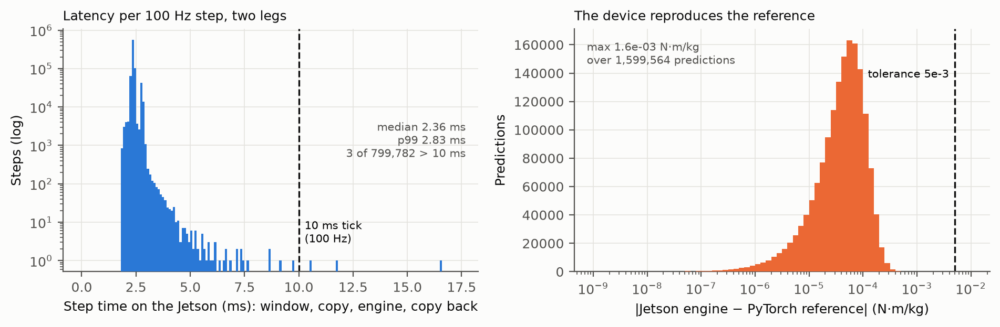
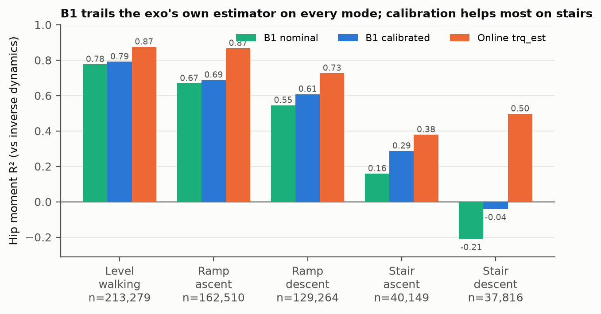
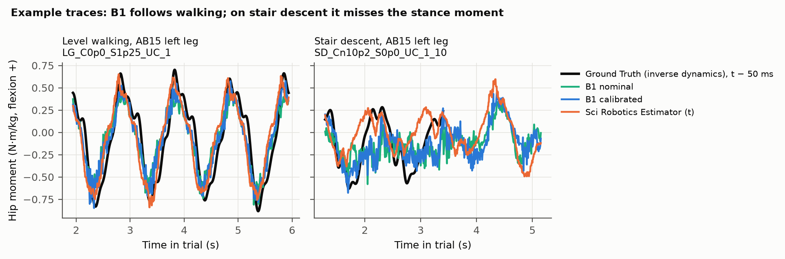
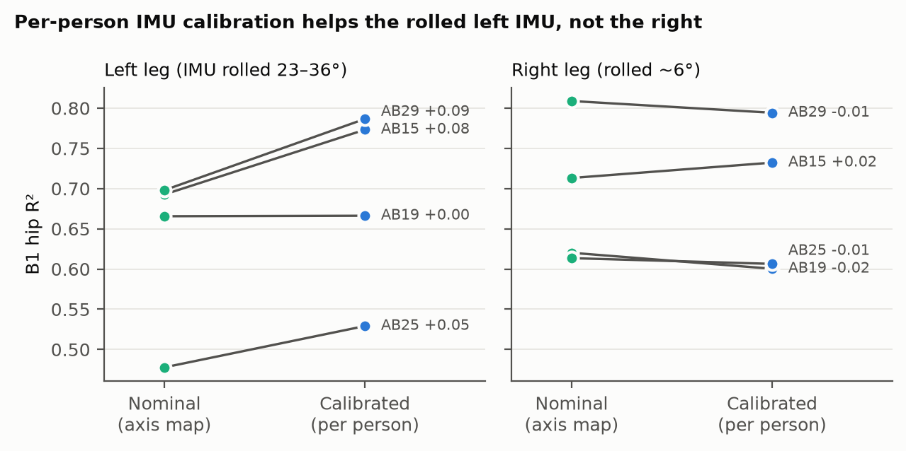
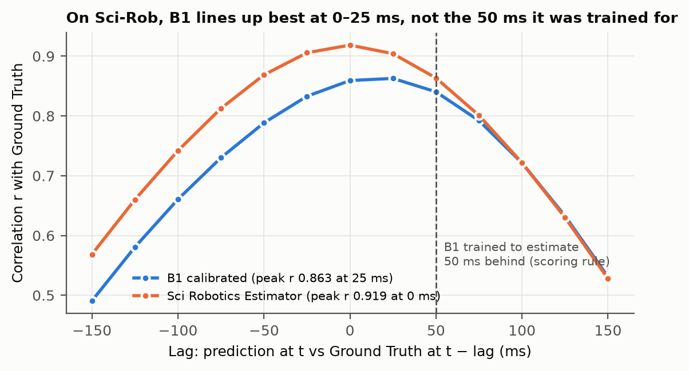
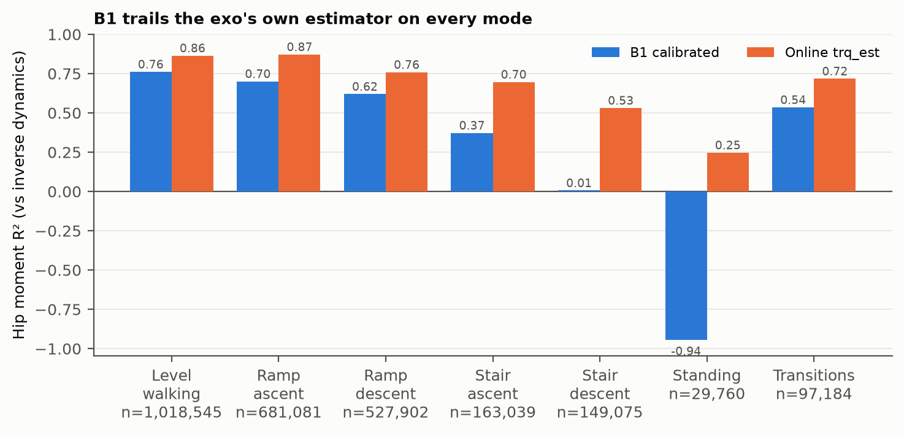
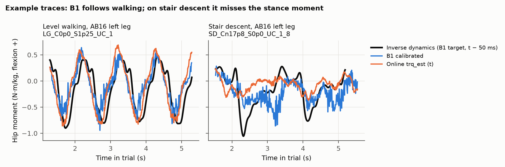

# D03: Stage A replay: B1 streamed on the Jetson over Sci-Rob exo recordings, against inverse dynamics and the exo's online estimator

| Field | Value |
|---|---|
| ID | D03 |
| Date | 2026-10-27 |
| Dataset | Science Robotics 2024 (Molinaro): AB15–AB34, custom hip exo, 1505 trials, 6.3 h, modes LG, RA, RD, SA, SD, ST, TR. None in B1's training data |
| Status | Complete. Dev 2026-10-27; final 16 predicted sealed on the Jetson overnight 2026-10-27 (D04's T1, calibrated) and scored once 2026-10-29 |
| Sources | D02 (the B1 engine), E41 (B1), E01 (Sci-Rob audit, axis conventions) |
| Code / notebooks | `deployment/scirob_replay.py` (converter, Mac), `replay_reference.py` (PyTorch reference, Mac), `replay_runner.py` (streaming replay, Jetson), `analyze_replay.py`, `plot_replay.py` (figures in `docs/figures/D03_*`); streams and predictions in `data/replay/scirob/` (gitignored) |

## Hypothesis

Stated before any result was seen.

- **(a)** Streaming the recordings sample by sample through the engine on the Jetson reproduces the PyTorch reference on
  every prediction (within D02's 5e-3 N·m/kg), on exactly the same samples.
- **(b)** Every step (window assembly, copy to the GPU, engine, copy back) stays under the 10 ms tick; p99 under 5 ms.
- **(c)** Per-person IMU calibration (the E41 deployment design) beats the bare axis map, mostly on the left leg, whose
  IMU sits rolled 23–36°, beyond B1's 15° training randomization.
- **(d)** On a new device and new people, B1 loses accuracy against its Nature test level (Phase 3 hip R² 0.70) but stays
  usable. The online estimator, built for this exo and recorded running on it, is the stronger reference on these
  cyclic tasks.

## Method

- **Participants:** dev = AB15, AB19 (phase 3), AB25, AB29 (phase 4), used for every decision; final = the other 16,
  scored once.
- **Conventions, measured on walking in both datasets** (encoder vs mocap angle, mean accelerometer, sagittal gyro vs
  encoder velocity), 4 Nature and 6 Sci-Rob participants:
  - Encoder: Sci-Rob rad, Nature deg, both extension-positive (Nature −50…+10°, Sci-Rob −0.7…+0.1 rad).
  - Thigh IMU: Nature `(x, y, z)` = Sci-Rob `(z, x, y)`: up +x (9.8 m/s²), mediolateral +y (sagittal gyro, gain −0.6
    to −0.9 against encoder velocity in both datasets), anterior +z. A proper rotation with no sign flips, matching the
    repository's `NATURE_ANATOMICAL`. Gyro rad/s → deg/s.
  - Velocity recomputed from the angle (`features.get_causal_velocity`), as B1 was trained.
  - Left leg mirrored by the replay, from the engine's `moment.json`, as the device will do.
- **Two IMU variants:**
  - *nominal*: the axis map alone.
  - *calibrated*: per person and leg, `signals.solve_imu_frame` on their slowest level-ground trial ("up" = mean
    accelerometer while walking; no quiet standing is recorded), rotated onto the average Nature IMU frame solved the same
    way on the Nature training participants' walking.
  - The converter fails unless the sagittal gyro anti-correlates with encoder velocity (r < −0.5), gravity is mostly on
    +y, and, calibrated, the mean gravity direction equals the Nature average (cosine > 0.999).
- **Predictions:** every 2nd sample (100 Hz, the deployed cadence) whose 249-sample window is complete and finite; both
  legs per call.
  - Mac reference: PyTorch, batched, CPU.
  - Jetson: one sample at a time into a ring buffer per leg, one engine call per tick, timed (engine only, and the full
    step).
- **Scoring (`analyze_replay.py`):**
  - B1's prediction at *t* against the inverse-dynamics hip moment at *t* − 10 (it estimates 50 ms behind); the online
    estimate `trq_est` at *t*.
  - All three compared on the same samples: where B1, `trq_est` and the moment all exist (the moment only exists on the
    force plates).
  - Sci-Rob's moment sign relative to B1, from dev only: the sign that makes B1's correlation with the moment positive.
  - R², RMSE, r pooled, per mode, per participant, per leg; Jetson vs reference difference; step latency.

## Result

Dev participants (AB15, AB19, AB25, AB29), 583,018 leg-samples where B1, the online estimate and the moment all exist.
Moment sign from dev: Sci-Rob's moment and `trq_est` are opposite to B1's (OpenSim) convention, r about −0.86; flipped.

**Jetson vs reference.** 1,599,564 predictions over both variants, on exactly the same samples (asserted): max
difference 1.6e-3 N·m/kg, 99.9th percentile 3.4e-4.

**Timing on the Jetson** (799,782 streaming steps, two legs each): step median 2.36 ms, p99 2.83 ms, p99.99 4.44 ms; engine
alone 1.90 ms median. 51 steps over 5 ms, 3 over 10 ms (max 16.5 ms), in a plain Python process with no real-time
priority. Throughput 2.2× real time.

**Accuracy, hip R² (RMSE N·m/kg):**

| | n | B1 nominal | B1 calibrated | Online `trq_est` |
|---|---|---|---|---|
| Pooled | 583,018 | 0.679 (0.229) | 0.707 (0.219) | **0.838 (0.163)** |
| Left leg | 295,995 | 0.657 | 0.716 | 0.827 |
| Right leg | 287,023 | 0.702 | 0.696 | 0.849 |
| LG | 213,279 | 0.777 | 0.791 | 0.875 |
| RA | 162,510 | 0.669 | 0.688 | 0.867 |
| RD | 129,264 | 0.545 | 0.608 | 0.727 |
| SA | 40,149 | 0.159 | 0.287 | 0.379 |
| SD | 37,816 | −0.210 | −0.041 | 0.497 |
| AB15 / AB19 / AB25 / AB29 | | 0.70 / 0.64 / 0.55 / 0.75 | 0.76 / 0.63 / 0.57 / 0.79 | 0.84 / 0.81 / 0.79 / 0.89 |

ST and TR have no samples with inverse dynamics.

**Timing alignment (diagnostic).** Correlation of each prediction at *t* with the moment at *t* − lag: B1 peaks at lag
0–5 samples (r 0.859–0.863) rather than the 10 it was trained for (0.840); `trq_est` peaks at 0 (0.919). Sci-Rob's
inverse-dynamics moment appears to sit about 25–50 ms later relative to the sensors than Nature's. Scored at its best lag,
B1 would gain roughly 0.02 in r; the fixed rule (lag 10) is kept for every number above.

- **(a) holds.** The streaming replay on the Jetson is the reference to 1.6e-3 N·m/kg (TF32 rounding over 1.6 M
  predictions); no sample was predicted on one side and not the other.
- **(b) holds for p99 (2.83 ms), not for "every step":** 3 of 799,782 steps exceeded the 10 ms tick, consistent with
  operating-system or garbage-collector pauses in an unprioritized Python process.
- **(c) holds.** Calibration adds 0.059 R² on the left leg (rolled 23–36°) and nothing on the right (−0.006); pooled
  +0.028, better on 3 of 4 people (AB19 −0.010). It helps most on stairs (SA +0.13, SD +0.17).
- **(d) holds.** B1 is usable on level and inclined walking (calibrated 0.69–0.79) but behind the online estimator on
  every mode (pooled 0.707 vs 0.838), and fails on stair descent. The online estimator was built for this exo and these
  tasks; B1 has never seen this device, its sensor mounting, or Sci-Rob's moment timing.

### Final participants (scored once, 2026-10-29)

The other 16 participants, calibrated variant only (chosen on dev), predicted on the Jetson by D04's T1 and analyzed once
with the dev-derived sign and the fixed lag-10 rule. 2,666,586 leg-samples where B1, `trq_est` and the moment all exist.

| | n | B1 calibrated | Online `trq_est` |
|---|---|---|---|
| Pooled | 2,666,586 | **0.698** (0.227) | **0.843** (0.164) |
| Left / right leg | | 0.740 / 0.656 | 0.860 / 0.826 |
| LG | 1,018,545 | 0.761 (0.216) | 0.864 (0.162) |
| RA | 681,081 | 0.700 (0.261) | 0.872 (0.170) |
| RD | 527,902 | 0.620 (0.207) | 0.759 (0.164) |
| SA | 163,039 | 0.372 (0.237) | 0.697 (0.163) |
| SD | 149,075 | 0.006 (0.243) | 0.531 (0.168) |
| ST | 29,760 | −0.944 (0.125) | 0.247 (0.078) |
| TR | 97,184 | 0.535 (0.171) | 0.717 (0.133) |
| Per participant, range | | 0.551–0.804 | 0.729–0.938 |

- **The final participants reproduce dev:** pooled B1 0.698 against dev's 0.707, the online estimator 0.843 against
  0.838. B1 is below the online estimator for all 16 people, and for every mode.
- Standing (ST) has little moment variance, so R² is unstable there; its RMSE is the small one (0.125 N·m/kg), still
  above the online estimator's 0.078.
- The right leg is now the weaker one (0.656 vs left 0.740; dev 0.696 vs 0.716).

## Conclusion

- **The engine path is verified end to end on the device:** a converter from this lab's exo data, streaming at the
  deployed cadence, reproduces the reference within 1.6e-3 N·m/kg at 2.4 ms per tick.
- **Use the calibrated variant** (the E41 design) for the final participants and the device. The bare axis map loses
  0.06 R² on a rolled IMU.
- **Cross-device accuracy is the gap, not the engine.** On this exo B1 trails the device's own estimator by 0.13 R²,
  most on stairs. Candidate causes, testable next: the moment-timing offset (about 0.02 r), stair loading the thigh
  cannot see (E41's unseen-task finding), and the accelerometer scale errors on AB28 and AB29.
- **For the real-time loop:** run with real-time priority or isolate the core; 3 in 800,000 steps missed a tick here.
- **Held out, the result stands:** on 16 new people B1 reaches R² 0.70 on this exo against the device's own estimator's
  0.84; the gap is largest on stairs and standing. These 16 have now been used once; later B1 variants need new held-out
  data (or the dev participants, already spent on decisions, for development).
