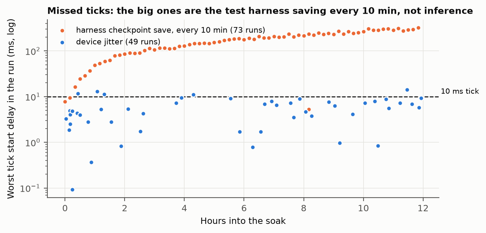
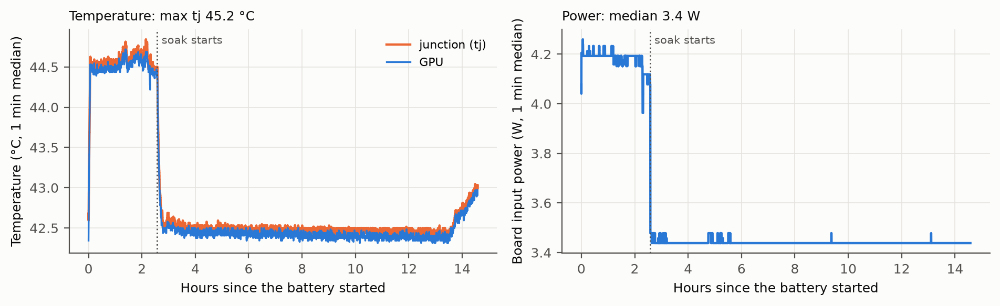
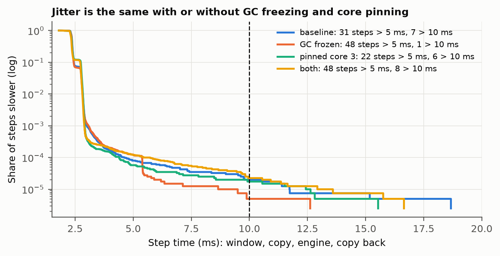
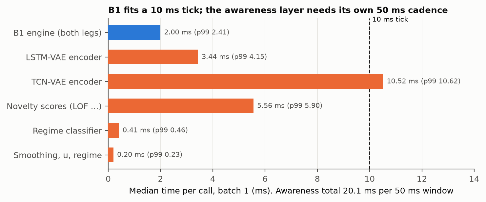

# D04: Device timing and stability on the Jetson: latency budget, jitter sources, fp16, and a 12 h soak

| Field | Value |
|---|---|
| ID | D04 |
| Date | 2026-10-27 16:59 – 2026-10-28 07:34 (unattended; shut itself down on schedule); analyzed 2026-10-29 |
| Dataset | Sci-Rob replay streams (D03): dev participants for the jitter and fp16 runs, all 20 for the soak |
| Status | Complete. Every step exited 0 |
| Sources | D02 (B1 engine), D03 (streaming replay: 3 of 799,782 steps over 10 ms) |
| Code / notebooks | `deployment/overnight.sh` (battery), `replay_runner.py` (`--gc-freeze`, `--cpu`, `--engine`), `latency_budget.py`, `soak_test.py`, `analyze_device.py` (numbers and figures); Jetson logs `~/hip-exo/logs/overnight/` (incl. `tegrastats.log`), outputs `~/hip-exo/data/replay/scirob/{predictions/jitter_*, predictions/jetson_fp16, soak/soak.npz, latency_budget.json}` |

## Hypothesis

Stated before the battery ran. A 2-trial smoke run of every step (2026-10-27 16:47) had already shown the awareness
encoders at about 21 ms per window together; (c) is written with that known.

- **(a) Jitter.** D03's rare slow steps (51 over 5 ms, 3 over 10 ms in 799,782) come from Python's garbage collector or
  from scheduling. Freezing the collector and/or pinning the process to one core removes most of them, without root.
- **(b) fp16.** The fp16 engine is no faster on real streams than fp32 (D02: not on synthetic windows either) and stays
  within its 3e-2 N·m/kg tolerance on real validation windows.
- **(c) Latency budget.** B1 fits the 10 ms tick with large margin (about 2 ms). The awareness layer (two encoders,
  novelty scores, trees, smoothing) fits its 50 ms window cadence but not inside a 10 ms tick next to B1, so on the device
  it must run on its own cadence or thread; fp16 autocast shortens the encoders.
- **(d) Soak.** Streaming at true 100 Hz pacing for 12 h shows no drift: step-time percentiles and resident memory flat
  hour to hour, temperatures plateau well below throttling, and fewer than 1 in 10⁵ ticks miss their deadline.

## Method

- **Order** (most important first, so a late failure loses least): T1 (D03's sealed final scoring), T4 latency budget,
  T2 jitter, T3 fp16, T5 soak; then summary and shutdown. Each step logs separately and a failure does not stop the next.
  `tegrastats` logs temperatures, power, frequencies and memory every second throughout.
- **T2 jitter:** the dev replay (4 participants, calibrated, about 400,000 two-leg steps each) under four conditions:
  baseline; garbage collector collected, frozen and disabled before streaming (`--gc-freeze`); process pinned to core 3
  (`--cpu 3`, away from cpu0's interrupts); both. Measure: step-time median, p99, p99.99, counts over 5 and 10 ms.
- **T3 fp16:** `moment_engine.py --fp16` (synthetic check), `check_moment_real.py --engine moment_fp16.engine` (2048
  real validation windows), dev replay with the fp16 engine; compare to the fp32 replay (D03) prediction by prediction
  and in step time.
- **T4 latency budget:** batch 1, 500 timed calls after 50 warm-up, CUDA synchronized: LSTM-VAE encoder (16 ch, 600
  samples) and TCN-VAE encoder (23 ch, 600 samples) with random weights of the deployed architectures (latency does not
  depend on weight values; no trained awareness model was sent), fp32 and fp16 autocast; novelty scores against 15,000
  reference latents; 183 stand-in trees of depth 6; smoothing and regime; the real B1 engine.
- **T5 soak:** 12 h, absolute 10 ms schedule; each tick pushes the next two 200 Hz samples (cycling through all 20
  participants' calibrated streams) and runs one two-leg engine call. Per tick: step time, wake-up lateness, missed
  deadline (step ending after the next tick's start). Resident memory every minute. Checkpointed every 10 min.
- **Not covered:** CAN I/O, building windows and rhythm features from live data, real-time scheduling priority (needs
  root), other power modes.

## Result

**T5 soak** (12 h, 4,320,000 ticks at true 100 Hz pacing, all 20 participants' calibrated streams):

- 1,576 ticks missed their deadline (3.6e-4), but **1,514 of them are the test harness**: `soak_test.py` saves its
  growing timing arrays to the SD card inside the loop every 10 minutes. Those 73 stalls sit exactly 10 minutes apart and
  grow steadily from about 5 ms to 320 ms as the file grows (to 36 MB). On a missed tick the step itself still took a
  median 1.75 ms; it started late.
- **The device's own misses: 62 in 4.32 M ticks (1.4e-5)**, in 49 short runs; 14 of them in the first hour. Steps over
  10 ms: 35 (8.1e-6); over 5 ms: 220.
- **No drift.** Step time median 2.22 ms, p99 2.67–2.70 ms in every hour, p99.99 3.96–4.42 ms after the first hour.
  Resident memory 905 MB at 1 min, 933 MB at 12 h (+3%).

- **Thermals and power:** junction temperature at most 45.2 °C (flat-out replays), 42.5 °C during the paced soak, flat
  until it rose about 0.5 °C in the last hour, most likely the room warming in the morning (the load was constant).
  Board input power 4.2 W flat-out, 3.4 W paced. RAM used at most 4.3 of 7.6 GB.

**T2 jitter** (dev replay, calibrated, flat out, 399,891 steps per condition):

| Condition | Median | p99 | p99.9 | p99.99 | > 5 ms | > 10 ms | Max |
|---|---|---|---|---|---|---|---|
| Baseline | 2.37 | 2.83 | 3.01 | 4.51 | 31 | 7 | 18.7 |
| GC frozen | 2.36 | 2.82 | 3.07 | 5.38 | 48 | 1 | 12.6 |
| Pinned to core 3 | 2.35 | 2.84 | 2.91 | 4.39 | 22 | 6 | 15.5 |
| Both | 2.34 | 2.81 | 2.90 | 5.43 | 48 | 8 | 16.7 |

**T3 fp16:** synthetic check 9.0e-4 N·m/kg; real validation windows 1.6e-3 against PyTorch fp32, R² 0.7530 (fp32 engine
0.7530). On the dev replay, fp16 vs fp32 over 799,782 predictions: max 6.4e-3, 99.9th percentile 1.2e-3 N·m/kg; R²
against inverse dynamics 0.7067 vs 0.7066. Step median 2.21 vs 2.37 ms (engine alone 1.90 vs 2.00 ms), p99 2.73 vs 2.83.

**T4 latency budget** (batch 1, median / p99 ms):

| Component | fp32 | fp16 autocast |
|---|---|---|
| B1 engine (both legs) | 2.00 / 2.41 | |
| LSTM-VAE encoder (PyTorch) | 3.44 / 4.15 | 5.92 / 6.32 |
| TCN-VAE encoder (PyTorch) | 10.52 / 10.62 | 10.92 / 11.04 |
| Novelty scores (LOF over 15,000, Mahalanobis, variance) | 5.56 / 5.90 | |
| Regime classifier (183 trees) | 0.41 / 0.46 | |
| Smoothing, *u*, regime | 0.20 / 0.23 | |
| **Awareness layer per window** | **20.1** | |

- **(a) does not hold.** Freezing Python's garbage collector, pinning to one core, or both leave the tail where it was:
  1–8 steps over 10 ms per 400,000 in every condition, and no consistent ordering. The slow steps are not Python
  collection or core migration; the remaining suspects need root to test (real-time scheduling priority, isolating a
  core from the kernel, the GPU driver).
- **(b) partly holds.** fp16 stays well within its tolerance on real data and loses nothing in accuracy (R² 0.7067 vs
  0.7066), but it is slightly faster after all: 0.16 ms per step (7%), 0.10 ms in the engine.
- **(c) holds, except fp16.** B1 takes a fifth of the 10 ms tick. The awareness layer takes 20 ms per window, inside its
  50 ms cadence but far beyond one tick, and the TCN-VAE encoder alone (10.5 ms) exceeds a tick. fp16 autocast makes both
  PyTorch encoders slower at batch 1 (casting overhead), not faster.
- **(d) holds for drift; the miss target is narrowly missed.** No drift in latency, memory or temperature over 12 h. The
  device's own miss rate is 1.4e-5 (1.2e-5 after the first hour) against the hypothesized < 1e-5; the harness's own
  checkpointing caused 96% of the misses.

## Conclusion

- **B1 is ready for a real-time loop on this board:** 2.2–2.4 ms per tick, stable for 12 h, cool (≤ 45 °C) and at 3–4 W.
  Either engine precision works; fp16 is 7% faster at no measured accuracy cost.
- **Design the controller as two loops.** B1 every 10 ms tick; the awareness layer (20 ms) on its own 50 ms cadence in a
  separate thread or process, feeding the latest regime to the fast loop. Running it inside the tick would miss every
  deadline. Converting the encoders to TensorRT was tested in D05: the TCN-VAE encoder drops to 2.1 ms, the LSTM-VAE
  encoder gets slower, so the layer comes to about 11.7 ms. Dropping LOF (plan step 4) saves 5.6 ms more.
- **Never write files inside the control loop.** The harness's own SD-card writes caused 96% of the missed ticks and
  grew with file size. The deployed loop's per-row CSV logging (`online_deployed/data_logger.py`, flushed every row) is
  the same pattern: log from a separate thread or buffer, and measure it.
- **The residual jitter (about 1 tick in 70,000)** is not fixed by unprivileged Python changes. Next to try, with sudo:
  `chrt` real-time priority and an isolated core; the controller should also tolerate an occasional late tick (hold the
  last command) rather than assume none.
- `soak_test.py` should checkpoint from a background thread before it is reused.

## Next steps

- Build the controller as two loops (B1 at 100 Hz; awareness at 20 Hz in its own thread or process), with the TCN-VAE
  encoder as a TensorRT engine and the LSTM-VAE encoder in PyTorch (D05).
- Move all logging out of the control loop (buffer + background writer), including the lab pipeline's per-row CSV
  logger, and re-measure.
- With sudo: test `chrt` real-time priority and an isolated core against the residual jitter; make the loop hold the
  last command on a late tick.
- Fix `soak_test.py` to checkpoint from a background thread before reusing it.
